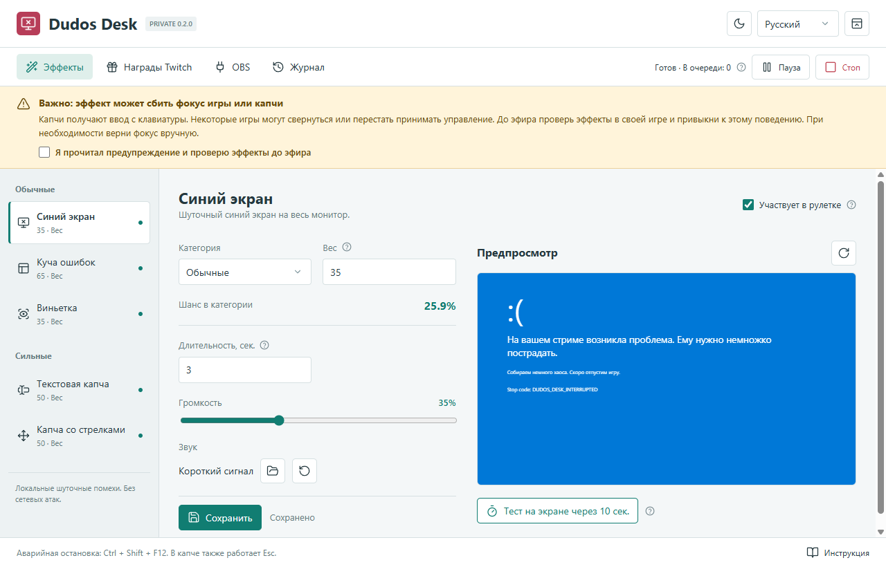
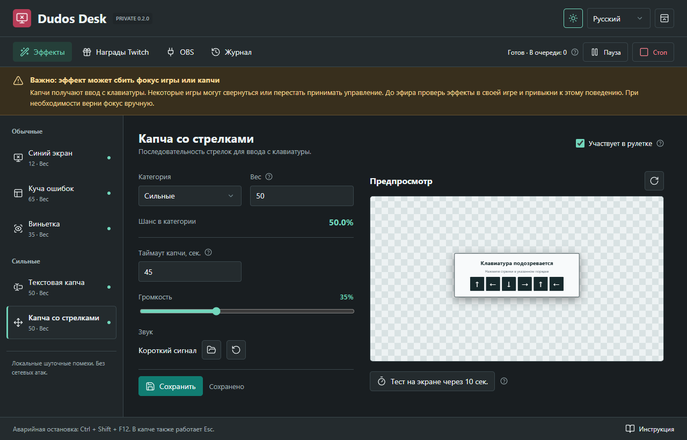
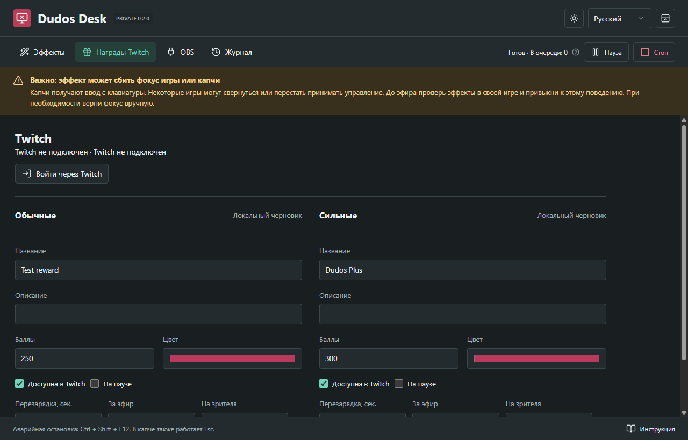
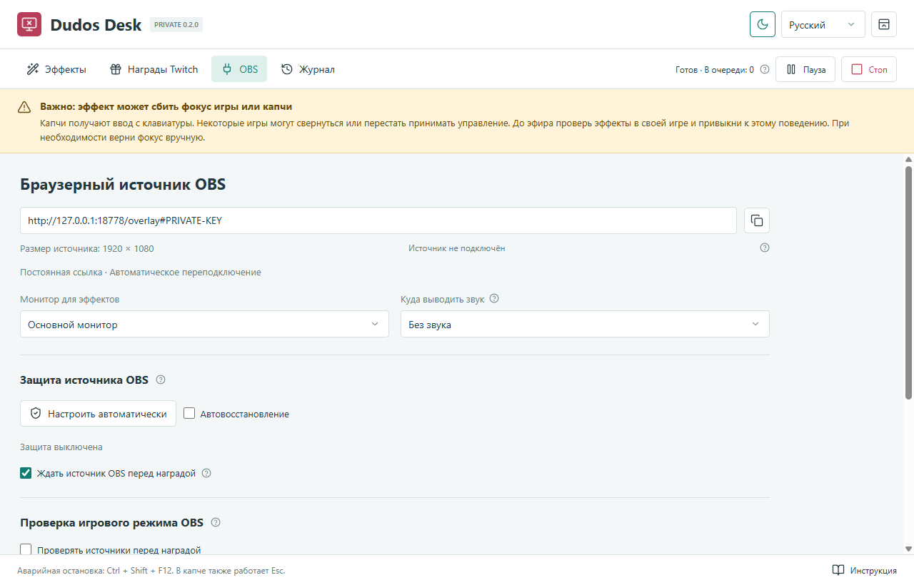

# Dudos Desk

**Приватная тестовая версия 0.2.0 · Windows 10/11 x64 · RU / UK / EN**

Локальные шуточные помехи поверх игры с отдельным источником для OBS. Основано на механиках прежнего приложения «Дудос»: синий экран, окна ошибок, виньетка, текстовая и стрелочная капчи. Это развлекательное приложение, **не программа для сетевых атак**.

> [!WARNING]
> **При появлении «Дудоса» может слетать фокус с игры или капчи.**
> Капчи специально получают ввод с клавиатуры. В зависимости от игры, полноэкранного режима и прав запуска игра может свернуться или перестать принимать управление. Фокус может потребоваться вернуть вручную, в том числе щелчком по полю капчи.
> **До эфира обязательно проверь эффекты в каждой своей игре и привыкни к этому поведению.** Не начинай проверку в соревновательном матче или при несохранённом прогрессе. Оконный режим без рамки обычно удобнее; совместимость с каждой игрой не гарантируется.
>
> Аварийная остановка: **Ctrl + Shift + F12**, кнопка **«Стоп»** или пункт **STOP** в трее. В активной капче также работает **Esc**. Каждый эффект ограничен по времени: не больше 120 секунд.

## Скриншоты






## Возможности

- Пять эффектов с включением, категорией, весом выпадения, длительностью и громкостью.
- Две независимые рулетки: обычная и сильная. Шансы показаны в процентах; вес 0 исключает эффект. Повторы возможны.
- Выбор своего аудиофайла, монитор для эффектов, звук только себе, только в OBS, обоим или без звука.
- Предпросмотр внутри приложения без перехвата фокуса. Реальный тест запускается с задержкой 10 секунд, его можно отменить.
- Очередь до 20 ожидающих эффектов, пауза, аварийная остановка и журнал последних событий.
- Прямой вход Twitch, создание двух наград, редактирование цены, цвета, описания, лимитов и перезарядки. Внешний бот не нужен.
- EventSub и резервная проверка незавершённых покупок каждые 15 секунд с общей защитой от дублей.
- Браузерный источник переподключается после перезапуска приложения; отдельная кнопка настраивает восстановление зависшего источника через локальный OBS WebSocket.
- Необязательная проверка источников OBS: например, вернуть баллы при активном источнике консоли или VR.
- Светлая/тёмная тема, русский/украинский/английский язык на лету.
- Единый профиль для установленной и portable-версии на одном Windows-аккаунте, резервные копии и защита от подмены потерянной базы пустой.

## Установка

В приватном [разделе Releases](https://github.com/foolka/dudos-desk/releases) доступны:

- `dudos-desk-0.2.0-windows-x64-setup.exe`: установка для текущего пользователя, ярлыки в меню «Пуск» и на рабочем столе.
- `dudos-desk-0.2.0-windows-x64-portable.zip`: распаковать **всю папку**, запустить `DudosDesk.exe`. Установка и отдельно установленный Node.js не нужны.
- Файлы `.sha256` для проверки целостности.

Сборка пока не подписана платным сертификатом. Windows может показать SmartScreen; сверяй источник и контрольную сумму, не отключай защиту Windows. Автоматическое закрепление ярлыка на панели задач Windows не гарантируется: используй «Закрепить на панели задач» у своего ярлыка.

Старое приложение DDOS не обновляется и не удаляется. Его настройки и награды не импортируются автоматически. Новый профиль: `%APPDATA%\DudosDesk`. Portable означает запуск без установки, а не профиль на флешке. Установка и portable не должны работать одновременно: приложение использует единый идентификатор и одну базу.

## Первый запуск

1. Прочитай предупреждение о фокусе и подтверди его. До подтверждения реальные эффекты и награды не запускаются.
2. Во вкладке «Эффекты» настрой рулетку, сохрани изменения и проверь безопасный предпросмотр.
3. В «OBS» выбери нужный монитор. Нажми «Тест на экране через 10 сек.» и вернись в игру. До завершения тестов не подключай награды.
4. Добавь браузерный источник OBS с показанной ссылкой, размером **1920 × 1080**. Ссылка постоянна для этого профиля и содержит приватный ключ: не публикуй её.
5. Источник OBS является отдельным зеркалом. «Захват игры» обычно не захватывает окна поверх рабочего стола. При «Захвате экрана» проверь, не дублируется ли эффект.

### Звук

«Только мне» играет на системном устройстве вывода Windows. «Только OBS» играет в браузерном источнике. «Мне и OBS» включает оба пути. Проверяй микшер и не захватывай один сигнал второй раз через звук рабочего стола.

**Чтобы самому слышать звук браузерного источника OBS:** включи в свойствах источника «Управлять аудио через OBS», затем в расширенных свойствах аудио выбери для него **«Прослушивание включено / Monitor and Output»**, если звук должен слышаться и тебе, и зрителям. Устройство прослушивания выбирается в настройках OBS → Аудио → Расширенные → Устройство прослушивания. Режим **Monitor Only (mute output)** не отправляет звук зрителям.

## Награды Twitch

Приложение подключается напрямую к Twitch. Используется отдельная Public OAuth-регистрация Dudos Desk и Device Code Flow. Пользователю не нужно создавать регистрацию или отдельный аккаунт бота. Запрашивается только `channel:manage:redemptions`; токены хранятся зашифрованно средствами Windows. Для собственного форка замени публичный Client ID в `twitch-client.json`, Client Secret не нужен.

1. Открой «Награды Twitch» → «Войти через Twitch» → «Открыть Twitch» и подтверди код.
2. Настрой обычную и сильную награду, сохрани локальные черновики. Ноль в лимитах или перезарядке отключает соответствующее ограничение.
3. Нажми «Создать в Twitch». Нужен канал, которому Twitch предоставляет баллы канала. Сохранение черновика само по себе ничего не публикует.
4. После изменения опубликованной награды нажми «Обновить в Twitch». Удаление требует отдельного подтверждения и запрещено при незавершённых покупках.
5. Ранее созданные другим приложением награды не захватываются: Twitch разрешает управление только создавшему их Client ID. Старые награды и старый DDOS не удаляются и не изменяются автоматически. Отключи ненужные старые награды самостоятельно, чтобы зрители не покупали их вместо новых.

События приходят через EventSub. Раз в 15 секунд проверяются незавершённые покупки своих наград, в том числе после обрыва связи. Повторы проходят через ту же сохранённую проверку ID покупки. Неотправленное подтверждение или возврат сохраняются и повторяются после восстановления сети без повторного эффекта.

По умолчанию включено «Ждать источник OBS перед наградой»: при отсутствии ответов источника новая покупка остаётся незавершённой, пока он не вернётся. Настройку можно выключить для использования только на рабочем столе.

Награда подтверждается после принятия в локальную очередь, не после завершения эффекта. Если нажать «Стоп», очередь очищается **без автоматического возврата уже подтверждённых покупок**. После аварийного закрытия очередь не воспроизводится повторно. Повторный запрос с тем же ID покупки не запускает эффект заново даже после перезапуска приложения.

### Необязательная проверка OBS

В «OBS» нажми **«Настроить автоматически»**. Приложение прочитает настройки локального OBS; вручную вводить пароль не нужно. Если WebSocket выключен, сначала потребуется закрыть OBS: исходная конфигурация сохраняется в зашифрованной резервной копии, затем включается защищённое соединение. При включённом WebSocket OBS закрывать не нужно.

Автовосстановление проверяет ответы источника. После 20 секунд отсутствия ответов обновляется только активный источник с точной ссылкой этого профиля. Не чаще раза в минуту и не больше трёх попыток за пять минут. Во время эффекта обновление откладывается. Удалённый источник не создаётся заново; полностью зависший OBS может потребовать ручного вмешательства. Открытая копия источника в обычном браузере также отвечает на проверку: закрой лишние копии после теста.

Для дополнительной проверки игрового режима введи точные имена игровых источников и источников, при которых эффект запрещён. Проверяется активность в Program, а не только наличие источника или его показ в Preview. Ручные поля порта и пароля доступны отдельно; они относятся к проверке игрового режима.

- Активен хотя бы один запрещённый источник: возврат баллов.
- Нет активного разрешённого игрового источника: возврат баллов.
- OBS недоступен, пароль неверен или источник не найден: покупка остаётся pending; эффект не запускается, резервная проверка повторит попытку.
- Приложение на паузе, очередь заполнена, предупреждение не подтверждено или категория пуста: покупка также остаётся pending.

В режиме без этой проверки решение о том, в какой игре включать награды, принимает стример. Dudos Desk ничего не меняет в сценах OBS, не останавливает эфир или запись.

## Безопасность и данные

Сервер слушает только `127.0.0.1:18778`; старый DDOS использует другой порт. Если порт занят, приложение сообщит об этом, а не сменит ссылку молча. Локальный HTTP API доступен только для чтения источника; внешнего API запуска эффектов больше нет. Управление настройками доступно только из окна приложения. История и резервные копии находятся локально. На старте и перед изменениями сохраняется до 20 резервных копий базы; медиа хранятся отдельно в `media` и не удаляются при смене звука.

Для полного ручного переноса сначала закрой приложение и копируй **весь профиль**, включая `media`. Пароль OBS защищён средствами Windows и на другом аккаунте может потребовать повторного ввода. Повреждённая или неожиданно отсутствующая существующая база не заменяется пустой.

## Українською

**Увага: під час появи ефекту може зникати фокус гри або капчі.** Капчі отримують введення з клавіатури; гра може згорнутися чи не реагувати на керування. До ефіру обов’язково перевір ефекти у своїх іграх і звикни до цієї поведінки. За потреби поверни фокус вручну. Аварійна зупинка: **Ctrl + Shift + F12**, «Стоп» або STOP у треї; у капчі також працює Esc.

Це локальні жартівливі ефекти, не мережеві атаки. П’ять ефектів, дві рулетки, попередній перегляд, прямий вхід Twitch, створення нагород, три мови та дві теми. EventSub доповнюється перевіркою незавершених покупок кожні 15 секунд. «Налаштувати автоматично» в розділі OBS підключає відновлення власного активного джерела. За замовчуванням нагороди чекають на джерело OBS. Профіль встановленої та portable-версії: `%APPDATA%\DudosDesk`. Старий DDOS не змінюється. Для OBS: 1920 × 1080; щоб чути джерело самому та передавати його глядачам, обери **Monitor and Output** у розширених властивостях аудіо.

## English

**Warning: an effect may take focus away from your game or captcha.** Captchas receive keyboard input. Depending on the game, fullscreen mode and privilege level, the game may minimize or stop accepting controls. Test every effect in your games before streaming and get used to this behavior; restore focus manually when necessary. Emergency stop: **Ctrl + Shift + F12**, **Stop**, or **STOP** in the tray. Esc also works in captchas. All effects time out within 120 seconds.

This is a local entertainment overlay, **not a network attack tool**. Five effects, two weighted roulettes, a safe preview, delayed desktop tests, queue controls, OBS mirroring, direct Twitch integration, three languages and two themes. Install the setup EXE or extract the entire portable ZIP. Both variants use `%APPDATA%\DudosDesk`; the legacy DDOS app is untouched.

Add a 1920 × 1080 OBS Browser source using the private URL in the app. To hear its audio yourself while sending it to viewers, use **Control audio via OBS → Advanced Audio Properties → Monitor and Output**, and choose your headphones as the monitoring device. Avoid double-capturing desktop audio.

Sign in through Twitch, save each reward draft, then explicitly create it on Twitch. Edit its price, color, prompt, limits and cooldown; zero disables a limit. Existing rewards owned by other clients are not modified. EventSub and a 15-second pending-redemption check share persistent deduplication. Failed fulfillment/refund requests retry without replaying the effect. Stop clears accepted effects without automatically refunding them. Interrupted queues are not replayed after a restart.

In OBS settings, **Set up automatically** configures local OBS recovery without password entry. Close OBS first only if its WebSocket server is disabled. Recovery refreshes only this profile’s active source, at most once a minute and three times per five minutes, never while an effect is running. Rewards wait for a responding source by default. A fully frozen OBS process still requires manual intervention. Close extra browser copies of the source after testing.

## Разработка

Node.js 24.14+ (24.x), Windows x64, Chrome для UI-проверок, Inno Setup 6 для установщика.

```powershell
npm ci
npm run assets
npm run styles
npm test
npm run test:ui
npm run test:overlay
npm audit --audit-level=high
npm run build
$env:ISCC_EXE = 'C:\path\to\ISCC.exe'
npm run installer
npm run portable
```

Тесты используют изолированные временные профили, не активируют реальные награды и не открывают помехи поверх рабочего стола. Публичная страница на сайте пока не создаётся: проект и релизы остаются приватными.
